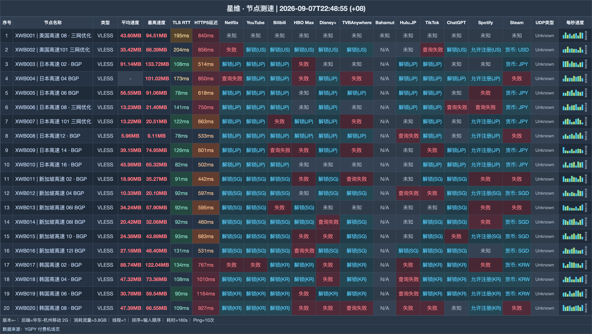

# 星维机场｜月付 8 元 160G，年付折合每月约 6.7 元（2026-11-09 更新）

> **一句话结论：低预算先用月付验证，确定长期使用后再把成本降到 80 元/年**
>
> 👉 **[官网注册](https://xinweicloud.com/?mode=register&invite=ICg5rb7n)** · 先买 8 元月付；稳定使用后再换 80 元年付 240G 档。

### 更适合以下预算安排：

- 想把第一次体验控制在 8 元
- 确定长期使用，愿意一次年付
- 用量不固定，需要永不过期流量包

### 如果在意这些，就要慎选：

- 换套餐时不接受流量重置
- 必须提前知道设备数和速度限制

| 选购项 | 结论 |
|---|---|
| 月付最低档 | 8 元 / 160G |
| 年付主推档 | 80 元 / 每月 240G |
| 年付月均 | 约 6.67 元 |
| 月付最大档 | 38 元 / 1000G |
| 不限时起步 | 20 元 / 200G |
| 协议 | VLESS |

**认识一下这家机场**：星维（xinwei）用 8 元 160G 降低首次门槛，80 元年付档每月 240G；偶尔使用的人还能选择可叠加的不限时包。

## 全部套餐怎么卖

| 套餐名称 | 费用 | 流量与周期 | 设备数 | 速度 | 购买须知 |
|---|---:|---:|---:|---:|---|
| 年付每月240G | ¥80/年付 | 240G / 每月 | — | — | 标题10+2，有效期明确365天 |
| 月付每月160G | ¥8/月付 | 160G / 每月 | — | — | — |
| 季付每月160G | ¥20/季付 | 160G / 每月 | — | — | — |
| 半年付每月160G | ¥40/半年付 | 160G / 每月 | — | — | — |
| 月付增强版每月300G | ¥15/月付 | 300G / 每月 | — | — | — |
| 季付增强版每月300G | ¥42/季付 | 300G / 每月 | — | — | — |
| 半年付增强版每月300G | ¥80/半年付 | 300G / 每月 | — | — | — |
| 月付超级增强版每月500G | ¥21/月付 | 500G / 每月 | — | — | — |
| 月付至尊增强版每月1000G | ¥38/月付 | 1000G / 每月 | — | — | — |
| 不限时200G | ¥20/一次性 | 200G / 用完为止 | — | — | 多次购买可叠加 |
| 不限时500G | ¥45/一次性 | 500G / 用完为止 | — | — | 多次购买可叠加 |

> 续购同一套餐不会重置流量；更换套餐会先折抵剩余价值，再重置流量。测速端为华东-杭州移动。

## 节点测速一览

测试收录 **20 个节点**，内容覆盖下载与延迟；测试端为 **华东-杭州移动 2G**，逐行结果放在下图。

## 短试、年付、总量包三选一

1. 不确定是否合用时，先买 8 元 160G，不要一开始就锁年付。
2. 确认长期使用后换 80 元年付，有效期 365 天、每月 240G，月均约 6.67 元。
3. 低频使用可买 20 元 200G 永不过期包，多次购买还能叠加。

## 从这里注册

👉 **[官网注册](https://xinweicloud.com/?mode=register&invite=ICg5rb7n)** · 先买 8 元月付；稳定使用后再换 80 元年付 240G 档。

*本文含推广链接；通过本文入口注册或购买，本站可能获得佣金。*

## 本文更新记录

- **2026-11-09** — 每日复核：套餐、价格与公告无变化；多账号发布对齐核查完成。
- **2026-11-08** — 每日复核：套餐、价格与公告无变化；多账号发布对齐核查完成。
- **2026-11-07** — 每日复核：套餐、价格与公告无变化；多账号发布对齐核查完成。
- **2026-11-06** — 每日复核：套餐、价格与公告无变化；多账号发布对齐核查完成。
- **2026-11-05** — 每日复核：套餐、价格与公告无变化；多账号发布对齐核查完成。
- **2026-11-04** — 每日复核：套餐、价格与公告无变化；多账号发布对齐核查完成。
- **2026-10-31** — 核对 11 个套餐/展示项，完成价量与限制整理。
- **2026-09-07** — 生成 B 版节点测速图，共 20 行。

---
*套餐、节点和活动可能调整，最终以购买页为准。*

展开相关搜索词

相关关键词：星维、xinwei、星维机场、xinweicloud、星维cloud、机场推荐、机场测评、机场推荐2026、科学上网、代理、VPN、clash 订阅、星维官网、星维注册、星维测速

