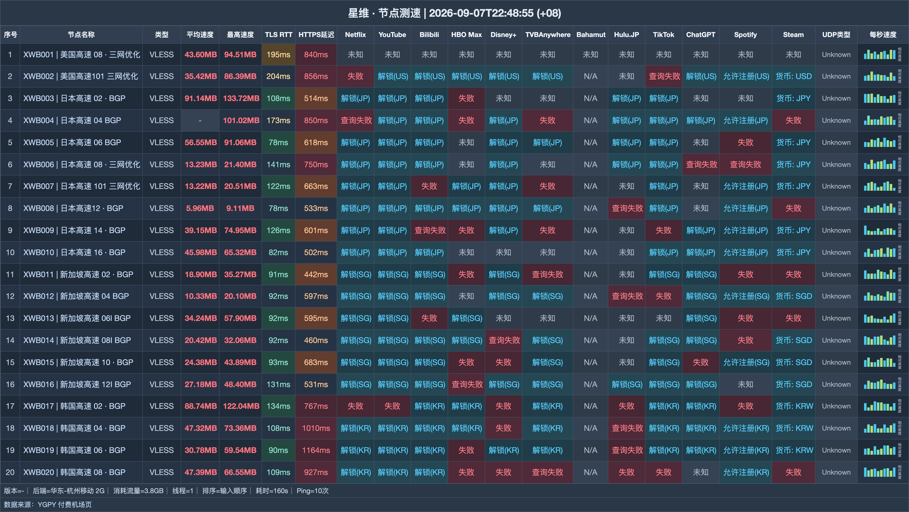

# 星维机场价格与套餐怎么选｜8 元月付、80 元年付、20 元不限时包（2026-11-20 更新）

> **价格结论先说：**第一次用选 **8 元/月 160G**；已经验证适合长期使用，选 **80 元/年、每月 240G**，折合约 **6.67 元/月**；只是偶尔使用，选 **20 元一次付 200G** 的不限时包。不要为了年付月均更低，跳过月付试用。
>
> 👉 **[官网注册](https://xinweicloud.com/?mode=register&invite=ICg5rb7n)** · 先买 8 元月付验证；确定长期使用后再考虑 80 元年付。

## 星维价格速览

| 使用方式 | 优先看哪档 | 价格 | 流量 | 购买判断 |
|---|---|---:|---:|---|
| 第一次短试 | 月付每月 160G | **8 元/月** | 160G / 每月 | 前期支出最低，不锁长周期 |
| 连续用三个月 | 季付每月 160G | **20 元/季** | 160G / 每月 | 总价低于按月买三次 |
| 长期固定使用 | 年付每月 240G | **80 元/年** | 240G / 每月 | 月均约 6.67 元，且月流量更多 |
| 月流量约 300G | 月付增强版 | **15 元/月** | 300G / 每月 | 不必为 500G 档多付预算 |
| 偶尔使用 | 不限时 200G | **20 元一次付** | 200G / 用完为止 | 不按月清零，可叠加 |

**最简单的买法：**“短试、长用、低频”三选一。还没用过，先买 8 元月付；已经连续使用并确认适配，再用 80 元年付降低月均成本；几个月才用完 200G，就选不限时包，而不是按月续费。

**适合：**

- 想把第一次体验控制在 8 元。
- 已确认长期使用，愿意一次支付 80 元年费。
- 每月需要 300G、500G 或 1000G，有明确升级档位。
- 用量不固定，需要可叠加、用完为止的不限时流量包。

**不适合：**

- 换套餐时不接受流量重置；更换套餐会先折抵剩余价值，再重置流量。
- 购买前必须知道设备数或速度限制；现有套餐资料没有这两个数字。
- 尚未试用，却只因年付月均更低就准备直接锁一年。

## 核心购买指标

| 选购项 | 结论 |
|---|---|
| 月付最低档 | 8 元 / 160G |
| 季付基础档 | 20 元 / 每月 160G |
| 年付主推档 | 80 元 / 每月 240G |
| 年付月均 | 约 6.67 元 |
| 月付最大档 | 38 元 / 1000G |
| 不限时起步 | 20 元 / 200G |
| 协议 | VLESS |
| 设备数与速度 | 现有套餐资料未列 |

## 全部套餐价格表

### 160G 基础系列：按承诺周期选择

| 套餐名称 | 费用 | 每月流量 | 总支付 | 与 8 元月付连续购买相比 |
|---|---:|---:|---:|---:|
| 月付每月 160G | **8 元/月** | 160G | 8 元 | 基准 |
| 季付每月 160G | **20 元/季** | 160G | 20 元 | 低于逐月购买总价 |
| 半年付每月 160G | **40 元/半年** | 160G | 40 元 | 低于逐月购买总价 |

季付与半年付降低连续购买总价，但第一次使用仍应先用月付验证；省下的金额不足以抵消选错线路后的整周期损失。

### 增强月付系列：按每月流量升级

| 套餐名称 | 费用 | 每月流量 |
|---|---:|---:|
| 月付增强版 | **15 元/月** | 300G |
| 月付超级增强版 | **21 元/月** | 500G |
| 月付至尊增强版 | **38 元/月** | 1000G |

另有 **42 元/季、每月 300G** 与 **80 元/半年、每月 300G**。同为 300G 档，先根据自己愿意承诺的周期选择，不把总支付较高误当成单月价格。

### 年付与不限时：两种不同购买逻辑

| 套餐名称 | 费用 | 流量与周期 | 购买须知 |
|---|---:|---|---|
| 年付每月 240G | **80 元/年** | 240G / 每月 | 标题 10+2，有效期 365 天 |
| 不限时 200G | **20 元一次付** | 200G / 用完为止 | 多次购买可叠加 |
| 不限时 500G | **45 元一次付** | 500G / 用完为止 | 多次购买可叠加 |

年付是按月获得 240G；不限时包是总量用完为止。它们不能只按“总价”或“流量数字”放在同一口径排名。

## 按预算和用量怎么选

### 预算只想控制在 8 元：选月付短试

8 元月付提供 160G，是进入成本最低的周期档。设备数与速度没有已核数字，第一次应把购买目标定为验证常用节点和本地网络适配，而不是追求长周期折算价。

### 已经确定连续使用：再比较季付、半年付与年付

基础 160G 档按月连续购买的总价高于表内季付与半年付。年付档不是简单延长 160G 套餐，而是 **80 元一年、每月 240G**，月均约 6.67 元。需要每月 240G 且已经试用通过，年付才是更明确的长期选择。

### 每月超过 160G：不要为周期折扣买错流量

- 每月约 300G：15 元月付增强版。
- 每月约 500G：21 元月付超级增强版。
- 每月约 1000G：38 元月付至尊增强版。

先按真实月流量定档，再决定是否拉长周期；如果 160G 本来就不够，季付基础档再便宜也不合适。

### 低频使用：20 元或 45 元不限时包

200G 包 20 元，500G 包 45 元，均为一次付、用完为止且可叠加。每月都用时，8 元月付的单价更低；用量跨越多个自然月时，不限时包更容易避免周期浪费。

## 套餐陷阱与限制

1. **年付月均低，不代表第一次就该年付。** 80 元要一次支付，先用 8 元月付验证能把选错成本压低。
2. **换套餐会重置流量。** 现有规则是先折抵剩余价值，再重置流量；续购同一套餐不会重置。
3. **设备数与速度没有已核数字。** 不用别家参数填空，也不把测速图中的单次结果写成套餐限速。
4. **“10+2”不能自行扩写成折扣承诺。** 年付档已知总价 80 元、有效期 365 天、每月 240G；本文不推造额外赠送规则。
5. **没有本文已核的优惠码或限时库存。** 季付、半年付、年付的价差来自套餐周期，不称额外促销。

## 节点测速：只作试用参考

留存图收录 **20 个节点**，覆盖下载与延迟结果；测试端记录为 **华东-杭州移动 2G**。现有资料没有足够信息把图中每行归属确认成星维本次实测，因此下图保持显著警示，只用来说明购买前仍应以自己的 8 元月付试用为准。

> **图归属待确认：**不得把上图写成已确认的星维实测，也不得据此承诺速度、稳定性或节点解锁能力。

## 购买前核对

- [ ] 第一次是否先用 8 元月付，而不是直接支付 80 元年费。
- [ ] 每月真实流量更接近 160G、300G、500G 还是 1000G。
- [ ] 是否接受换套餐先折抵剩余价值、随后重置流量。
- [ ] 是否需要已知设备数或速度；需要则在购买页确认后再下单。
- [ ] 下单页再次核对价格、周期与套餐名称；本文不承诺未核实的实时库存或额外优惠。

## 星维价格 FAQ

### 星维最低多少钱？

最低周期档为 **8 元/月 160G**；最低不限时包为 **20 元一次付 200G**。前者按月，后者用完为止。

### 8 元月付和 80 元年付怎么选？

没用过先选 8 元月付；已经确认线路长期合用、每月需要约 240G，再选 80 元年付。年付折合约 6.67 元/月，但要一次支付全年费用。

### 20 元季付是不是比月付划算？

连续三个月使用时，表内季付总价低于逐月购买。前提是你确定会连续使用三个月；第一次仍建议月付。

### 20 元不限时包与 20 元季付有什么区别？

季付是三个月内每月 160G；不限时包是总计 200G、用完为止。总价相同，但流量刷新方式完全不同。

### 星维有优惠码吗？

本文没有已核优惠码或限时折扣。“10+2”只保留为年付档现有标题信息，不自行解释成额外优惠承诺。

### 星维怎么买更稳妥？

先通过下方入口注册，买 8 元月付；验证常用节点与本地网络后，再按每月用量选择增强档，或在确定长期使用后转 80 元年付。

## 注册与购买

👉 **[官网注册](https://xinweicloud.com/?mode=register&invite=ICg5rb7n)** · 第一次先买 8 元月付；确认长期使用后再选 80 元年付，低频使用改看不限时包。

## 重要更新

- **2026-11-20** — 每日复核：套餐、价格与公告无变化；多账号发布对齐核查完成。
- **2026-11-19** — 每日复核：套餐、价格与公告无变化；多账号发布对齐核查完成。
- **2026-11-18** — 重构为价格、套餐与购买决策版本；套餐价格沿用当日已复核内容。
- **2026-10-31** — 核对 11 个套餐/展示项，完成价量与限制整理。
- **2026-09-07** — 生成 B 版节点测速图，共 20 行；图归属仍待确认。

---
*价格与套餐以商家实时显示为准。测速图归属待确认，不作为已确认星维实测。*
